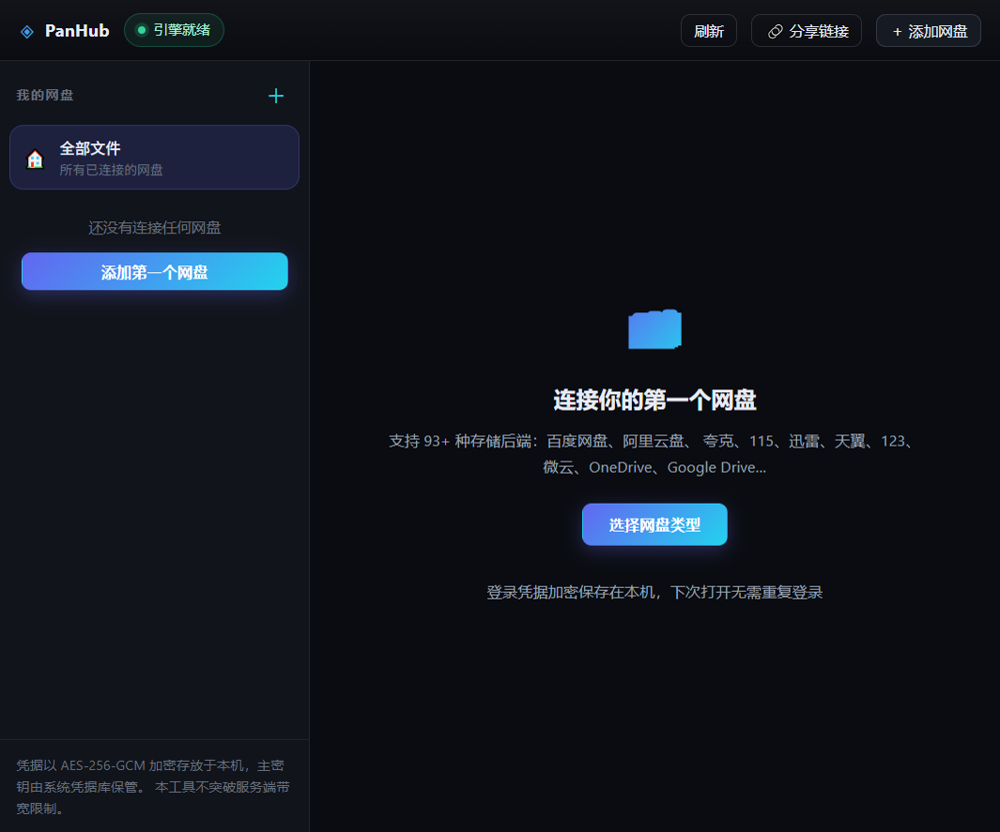
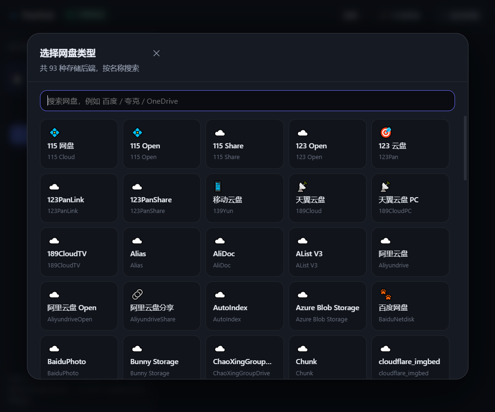

<div align="center">

# ◈ PanHub

**跨平台网盘聚合下载器 —— 一次登录，多网盘统一浏览与下载**



[](https://github.com/llllishuo/PanHub/actions/workflows/build.yml)


</div>

> [!WARNING]
> **本仓库全部代码由人工智能（AI）生成**，未经执业律师审查，也未经专业安全审计。
> 作者不对使用后果承担任何责任。完整条款见 **[DISCLAIMER.md](DISCLAIMER.md)**。
>
> - 本工具**不**破解、不绕过任何付费服务的带宽限制。速度取决于服务端对你账号的实际授权。
> - 自动化访问第三方网盘**可能违反其服务条款**，存在账号受限风险，**由使用者自行承担**。
> - 本项目与任何网盘服务商均无隶属、合作或授权关系。
> - 商业使用或对外分发前，请自行完成代码审计与法律合规评估。

---

## 它解决什么问题

你可能同时用着百度网盘、阿里云盘、夸克、115……每个都要装客户端、各自登录、各自限速。
PanHub 把这些收进**一个界面**：

- 装一次，登录一次，凭据**加密留在本机**，之后打开就能用
- 93 种存储后端用同一套浏览 / 下载逻辑
- 下载走**多线程分片 + 断点续传**，客户端侧不做任何限速

<table>
<tr>
<td width="50%"></td>
<td width="50%" valign="top">

**添加网盘不用写配置 JSON**

引擎会为每个驱动返回字段定义（`type` / `options` / `required` / `help`），
界面据此**自动生成表单**：

- 必填项前置，高级项折叠
- `cookie` / `token` 默认遮蔽，可切换显示
- 93 种后端共用一套添加流程

</td>
</tr>
</table>

---

## 快速开始

### 你需要先准备

| 项目 | 要求 |
|---|---|
| Node.js | **≥ 22**（项目用 `.ts` 直接跑测试，依赖原生类型剥离） |
| pnpm | 12.x（`corepack enable` 即可） |
| Python | 3.8+，仅用于下载引擎二进制 |
| 磁盘 | 约 1.5 GB（Electron 依赖 + 111 MB 引擎 + 构建产物） |

### 三步跑起来

```bash
# 1. 装依赖
pnpm install

# 2. 下载引擎二进制（111 MB，不入库）
python scripts/fetch_engine.py

# 3. 开发模式启动
pnpm dev
```

首次启动会拉起本地引擎并初始化加密保险箱，**大约需要 5–15 秒**，属正常现象。

### 打包成安装包

```bash
pnpm dist:win      # Windows  → release/PanHub-<ver>-win-x64.exe
pnpm dist:mac      # macOS    → release/PanHub-<ver>-mac-<arch>.dmg
pnpm dist:linux    # Linux    → AppImage + deb
```

> 国内网络下 electron-builder 从 GitHub 取 NSIS / 7zip 常被 `ECONNRESET` 打断：
>
> ```bash
> ELECTRON_BUILDER_BINARIES_MIRROR=https://npmmirror.com/mirrors/electron-builder-binaries/
> ```

---

## 上手引导

### 第 1 步：连接一个网盘

点右上角 **＋ 添加网盘** → 搜索网盘名 → 填写该驱动要求的凭据 → 添加。

不同网盘要准备的东西不一样，下表是常见的几类：

| 网盘 | 驱动 | 需要准备 | 备注 |
|---|---|---|---|
| 夸克 | `Quark` | `cookie` | 通常从浏览器开发者工具获取 |
| UC 网盘 | `UC` | `cookie` | 同上 |
| 115 | `115 Cloud` | `cookie` | |
| 百度网盘 | `BaiduNetdisk` | `refresh_token` | OAuth 流程，需自行获取 |
| 阿里云盘 | `AliyundriveOpen` | `refresh_token` | 官方已不维护旧驱动，建议用 Open 版 |
| 123 云盘 | `123Pan` | `accesstoken` | |
| 天翼云盘 | `189CloudPC` | `cookie` | |
| 腾讯微云 | `WeiYun` | `cookie` | |
| OneDrive | `Onedrive` | OAuth 相关字段 | 也支持 `Onedrive Sharelink`（分享链接） |
| 本地目录 | `Local` | 无需凭据 | 可作为下载目标或测试用 |

> 每个字段的说明来自驱动自带的 `help` 文本，添加对话框里会直接显示；
> 若某项 `help` 为空，说明上游驱动作者没写说明。

### 第 2 步：浏览与下载

- **双击**文件夹进入，`Backspace` 或左上角 `←` 返回上级
- 文件行上点 **下载** → 选择本地目录 → 自动开始多线程分片下载
- 底部任务条显示实时速度与剩余时间；点标题可展开全部任务
- 中断后重新下载同一文件会**自动续传**（读取已下载分片）

### 第 3 步：从分享链接添加

点 **🔗 分享链接**，粘贴链接即可。也支持直接粘贴「复制这段内容…提取码:xxxx」整段口令。

能解析哪些网盘、解析到什么程度，见下方 [分享链接：能力边界](#分享链接能力边界如实标注)。
**不支持的类型会明确告诉你，而不是假装能解析然后失败。**

### 键盘快捷键

| 按键 | 作用 |
|---|---|
| `Ctrl/Cmd + F` 或 `/` | 聚焦当前目录筛选框 |
| `Backspace` | 返回上级目录 |
| `Esc` | 关闭对话框 |
| 文件行 `Enter` | 打开文件夹 / 下载文件 |

---

## 当前状态

核心层、界面层与 Windows 打包链路均已实测通过；macOS / Linux 安装包由 GitHub
Actions 矩阵构建。为避免误导，逐项如实标注：

| 模块 | 状态 | 说明 |
|---|---|---|
| 加密保险箱 | ✅ 已验证 | AES-256-GCM，主密钥不落盘 |
| 多线程下载器 | ✅ 已验证 | 分片 / 续传 / 重试 / 进度 |
| 引擎进程管理 | ✅ 已验证 | 生命周期、安全基线、确定性终止 |
| 引擎 API 客户端 | ✅ 已验证 | 实测 93 个存储驱动 |
| 编排层（服务） | ✅ 已验证 | 会话目录隔离、静态加密、作业队列 |
| 端到端闭环 | ✅ 已验证 | 引擎→存储→列表→直链→下载→哈希一致 |
| Electron 主进程 + 界面 | ✅ 已实现 | 启停引擎、添加网盘、浏览、下载队列 |
| 各网盘登录引导 | 🟡 部分 | 按驱动字段自动生成表单；OAuth / 扫码引导未做 |
| 分享链接解析 | ✅ 已验证 | 13 类网盘识别；5 类可解析 |
| 三平台安装包 | 🟡 部分 | Windows 本机实测全通；macOS / Linux 由 CI 产出；Windows 的 CI 打包未通过 |

**测试证据**：65 个测试全部通过，连续多次运行稳定，结束后系统层面无残留子进程。

```bash
pnpm test        # 65 tests / 65 pass
```

> 测试分七组：保险箱安全属性（13）、下载器真实 HTTP 分片（10）、引擎进程管理（6）、
> 端到端集成（5）、编排层（4）、分享链接解析（16）、引擎路径解析（11）。
> 其中端到端组会真实拉起引擎、真实建存储、真实发 HTTP Range 请求，
> 并用 SHA-256 逐字节校验下载结果。

### 分享链接：能力边界（如实标注）

解析器只承诺引擎真的具备的能力。OpenList v4.2.9 只有部分网盘提供「分享」驱动：

| 网盘 | 识别 | 可解析 | 驱动 | 说明 |
|---|---|---|---|---|
| 阿里云盘 | ✅ | ✅ | `AliyundriveShare` | 仍需你自己的 `refresh_token` |
| 115 | ✅ | ✅ | `115 Share` | 需分享码 + 接收码 |
| 123 云盘 | ✅ | ✅ | `123PanShare` | 通常无需登录 |
| PikPak | ✅ | ✅ | `PikPakShare` | |
| OneDrive | ✅ | ✅ | `Onedrive Sharelink` | 直接接收完整链接 |
| 百度 / 夸克 / UC / 迅雷 / 蓝奏 / 天翼 / 微云 / TeraBox | ✅ | ❌ | — | 引擎没有对应分享驱动，界面会说明原因并给出替代做法 |

不支持的那 8 类**不会假装能解析**——解析结果里 `supported=false` 并附带原因。
把事情说清楚，比让用户以为能用然后失败要好。

---

## 设计要点

### 分层：核心零框架依赖

```
src/
├── core/               ← 零 Electron 依赖，纯 Node ESM，可被 node --test 直接覆盖
│   ├── vault.ts           加密保险箱（AES-256-GCM + AAD 绑定）
│   ├── downloader.ts      多线程分片下载（Range / 续传 / 重试）
│   ├── sidecar.ts         引擎子进程管理 + 安全基线
│   ├── client.ts          引擎 HTTP 客户端
│   ├── share.ts           分享链接解析（纯函数）
│   └── engine-path.ts     引擎路径解析（纯函数，依赖注入）
├── main/               ← Electron 主进程与编排层
│   ├── service.ts         编排（会话隔离、加密、作业队列）
│   └── index.ts           IPC 窗口与生命周期
└── renderer/           ← React 19 + TypeScript
```

核心层刻意不依赖 Electron，换来的是：**核心逻辑全部可 headless 验证**，
且更换 GUI 框架（Tauri / Wails）只需重写外壳。

### 性能取舍

- **进度事件攒批**：最多每 150ms 合并提交一次，避免每个任务每 200ms 就重渲染整棵树
- **`useSyncExternalStore` 隔离**：只有任务列表订阅进度，文件列表不跟着抖
- **`content-visibility: auto`**：长目录里浏览器跳过屏幕外行的渲染
- **`transform: scaleX()` 画进度条**：走合成层，不触发重排

### 安全基线（非可选项）

- 引擎**只绑 `127.0.0.1`**。引擎默认 `0.0.0.0`，那等于把你已登录的全部网盘连同管理接口暴露给整个局域网。
- 每次安装生成独立 `jwt_secret`，不用引擎默认值。
- `ftp` / `sftp` / `s3` / `mcp` 全部关闭，只留 HTTP。
- 管理密码随机生成，存入保险箱，不落明文。
- **明文只存在于一次性临时会话目录**：每次启动在系统临时目录新建工作目录，退出时把引擎数据
  （`config.json` / `data.db`）加密进保险箱再清理该目录。永久数据目录里**从不出现明文**。
  这样绕开了「Windows 上文件被别的句柄占住删不掉」的困境。
- 清扫历史会话目录时按 **pid 判断归属**，绝不误删仍在运行实例的工作目录。

> **需要清醒认识的风险**：凭据保存在本机意味着——**能登录你这台电脑的人，也就有机会使用你已登录的网盘**。
> 保险箱防的是「磁盘被拷走」和「配置文件被翻看」，不防「本机已被控」。

### 关于「不限速」的诚实说明

本项目**不做也不承诺不限速**，原因不是技术保守，而是两条硬事实：

1. **技术上无效**：主流网盘对非会员的限速是**账号级、服务端**执行的，直链本身携带带宽配额。客户端无论如何修改都突破不了服务端给的量。
2. **法律上踩线**：历史上靠服务端漏洞"提速"的方案在国内已被刑事追责，且服务商对异常流量直接封号——用户得到的不是"不限速"，而是"账号被封"。

本项目实际提供的是：**不做客户端限速 + 多线程分片并发**，尽量用满服务端授予的带宽。
对限客户端不限 API 的网盘效果接近满速；对严格限速的网盘，就是"给多少用多少"。

---

## 常见问题

<details>
<summary><b>启动后界面一直显示「引擎未启动」/ 白屏怎么办？</b></summary>

先看终端里的 stderr，会打印引擎路径与端口。常见原因：

- **引擎二进制缺失**：跑 `python scripts/fetch_engine.py`
- **端口被占**：应用会自动挑空闲端口，正常不会冲突；若反复失败请重启应用
- **从终端启动时继承了 `ELECTRON_RUN_AS_NODE=1`**：会导致 Electron 以纯 Node 模式运行、窗口不出现。
  这是本机环境变量污染，先 `Remove-Item Env:ELECTRON_RUN_AS_NODE` 再启动。

</details>

<details>
<summary><b>为什么不支持百度 / 夸克的分享链接？</b></summary>

不是没做，是**引擎没有对应的分享驱动**。OpenList v4.2.9 里只有 5 类网盘提供「分享」驱动。
百度、夸克等需要走各自的私有协议，引擎侧没有实现，界面只能如实告诉你并建议你转存后用账号驱动访问。

硬要"支持"就只能写死各家私有接口，那既脆弱又容易随对方改版失效。

</details>

<details>
<summary><b>凭据到底存在哪？安全吗？</b></summary>

- 凭据经 AES-256-GCM 加密后写入 `vault.json`，**AAD 绑定网盘 ID**，防止把 A 盘的凭据挪给 B 盘使用
- 主密钥交给系统凭据库（Windows DPAPI / macOS Keychain / Linux Secret Service）保管
- 系统凭据库不可用时退回基于 `scrypt` 的文件密钥，**会显著降低安全性**，仅为可用性兜底
- 文件权限 0600，写入采用原子替换

风险边界见上一节。

</details>

<details>
<summary><b>下载到一半断电 / 崩溃了，要重下吗？</b></summary>

不用。分片文件与状态记录保留在目标目录，下次对同一文件发起下载会自动读取已有分片续传。

</details>

<details>
<summary><b>卸载后我的登录信息还在吗？</b></summary>

在。安装包设置了 `deleteAppDataOnUninstall: false`，数据目录会保留，重装后无需重新登录。
需要彻底清除时，删除用户数据目录（Windows 为 `%APPDATA%\PanHub`）即可。

</details>

<details>
<summary><b>为什么安装包有 143 MB？</b></summary>

Electron 运行时约 120 MB（已压缩），OpenList 引擎解压后 111 MB。二者都不是本项目能"优化掉"的部分。
解压后占用约 477 MB。

</details>

---

## 引擎依赖

网盘协议适配由 [OpenList](https://github.com/OpenListTeam/OpenList) 提供（Go 单文件，实测 93 个驱动）。
二进制**不入库**（解压后 111 MB），用脚本获取：

```bash
python scripts/fetch_engine.py
```

产物路径：`resources/sidecar/<platform>-<arch>/openlist[.exe]`

脚本优先用 `curl` 下载，失败才退回 Python `urllib`：Windows runner 上 `urllib` 抓这个
37 MB 的 release 资产会稳定失败，而 Windows 自带 `curl.exe`。

---

## 打包

配置见 [electron-builder.yml](electron-builder.yml)。引擎二进制走 `extraResources`
（不进 asar），因此打包后仍位于 `resources/sidecar/<platform>-<arch>/`，
主进程在打包模式下从 `process.resourcesPath` 解析，与开发模式一致。

**关于 `electronDist`**：配置里**故意不设**它。一旦指向 `node_modules/electron/dist`，
就只能打宿主架构的包——CI 需要在一个 macOS runner 上同时产出 x64 与 arm64，那样会直接失败。
本地想省掉 200+ MB 下载时用命令行覆盖（`pnpm dist:*` 脚本已内置），CI 则用 `pnpm dist:ci`。

### 构建实测（Windows 10 / x64）

| 环节 | 结果 |
|---|---|
| `electron-builder --win --dir` | ✅ `release/win-unpacked`，asar 仅 8.6 MB（引擎未混入） |
| 免安装版启动 | ✅ 引擎从 `resources/sidecar/...` 正常拉起 |
| `electron-builder --win` | ✅ `PanHub-0.1.0-win-x64.exe`，143 MB |
| 静默安装 `/S /D=...` | ✅ 退出码 0，落盘 477 MB，引擎随包 |
| 启动已安装版本 | ✅ 引擎就绪 |
| 静默卸载 `/S` | ✅ 退出码 0，目录清空 |

**未验证的部分**：

- 未配置代码签名证书，安装包会触发 SmartScreen / Gatekeeper 提示
- 未设置应用图标，当前使用 Electron 默认图标
- macOS 产物未做公证（需要 Apple 开发者账号）
- macOS / Linux 产物由 CI 构建成功，但**未在真机上做运行时验证**（本仓库开发环境为 Windows）

### 持续集成：三平台构建

[`.github/workflows/build.yml`](.github/workflows/build.yml) 分两个阶段：

1. **test** —— ubuntu / windows / macos 三平台各跑一遍全部测试。
   这是必要的：测试里有大量路径与文件锁逻辑（Windows 的 EBUSY、会话目录清理、路径分隔符），
   只在 Linux 上跑会漏掉真实平台差异。
2. **package** —— 三个 runner 各出安装包：
   `windows-latest`(x64) / `macos-latest`(x64 + arm64) / `ubuntu-latest`(x64)。

**为什么 macOS 只用一个 runner**：原先用 `macos-13`(Intel) + `macos-14`(arm64)
两个 runner，实测 `macos-13` 排队 30 分钟以上仍未分配，直接把整个 run 卡在 `queued`
（各 job 早已跑完，run 状态却不结束）。现在改为在 `macos-latest` 上一次性跨架构打出两个 dmg。

#### CI 实测状态（截至最后一次运行）

| 阶段 | 状态 |
|---|---|
| test / ubuntu-latest | ✅ 通过 |
| test / windows-latest | ✅ 通过 |
| test / macos-latest | ✅ 通过 |
| package / macos | ✅ 产出 `panhub-macos`（306 MB，含 x64 + arm64 两个 dmg） |
| package / linux-x64 | ✅ 产出 `panhub-linux-x64`（283.5 MB，AppImage + deb） |
| package / windows-x64 | ❌ 未通过 |

**Windows 打包在 CI 上未解决**，具体卡点：测试阶段在 Windows runner 上能成功下载引擎，
且「上传引擎」步骤报告成功，但该 run 的 artifact 列表里始终没有 `engine-Windows`
（`engine-macOS` / `engine-Linux` 都正常）；打包阶段因此取不到，回退重新下载又失败。

受限于匿名请求无法读取 Actions 日志（logs 端点返回 403），目前只能观察到
「上传步骤成功但 artifact 不存在」这一现象，尚未定位根因。

**这不影响 Windows 产物的可用性**：Windows 安装包已在本机完整验证
（构建 → 静默安装 → 启动 → 引擎就绪 → 卸载），命令是 `pnpm dist:win`。

---

## 实测记录：引擎 v4.2.9 的两个行为陷阱

这两条是逆向验证得出的，已写成回归测试：

1. **首次启动不创建 admin 用户**（只建 `guest`）。此时 `openlist admin set <pw>` 会
   **退出码 0 但什么都不做**——若代码信任退出码，就会出现「设置成功却登不上」。
   正路是先 `POST /api/public/init/setup`。
2. **Local 驱动在 Windows 上会对小文件虚报大小**（实测 12 字节文件在 `Content-Range` 里报成 8192）。
   下载器因此以磁盘实际字节为准，不盲信服务端声称的总长度。

### 为什么引擎路径解析值得单独写测试

Node 的 `process.platform`、Python 的 `platform.system()`、electron-builder 的
`${os}` / `${arch}`、OpenList 发行包的架构名，**四套命名互不一致**
（`win32`/`windows`/`win`、`x64`/`amd64`）。任何一处对不上，表现都是「应用启动后引擎永远找不到」。

因此解析逻辑被抽成纯函数 [`src/core/engine-path.ts`](src/core/engine-path.ts)，依赖通过参数注入，
11 个用例在 Windows 上就能验证 macOS / Linux 的目录布局。写测试时它立刻抓到一个真 bug：
拼接路径时硬编码了 `\`，在 macOS/Linux 上会拼出 `/app/resources\sidecar\openlist`
这种不存在的路径——引擎必然起不来。

---

## 参与开发

```bash
pnpm dev          # 开发模式（热更新）
pnpm build        # 构建 out/
pnpm test         # 65 个测试，无需 Electron
pnpm typecheck    # 类型检查
```

提交前请确保 `pnpm test` 全绿。测试覆盖的是**行为**而非实现细节：
真实拉起引擎、真实发 HTTP Range 请求、真实校验 SHA-256。

---

## 许可证

[MIT](LICENSE) + [DISCLAIMER.md](DISCLAIMER.md)。
再分发时必须保留 **AI 生成声明**与**免责声明**。
